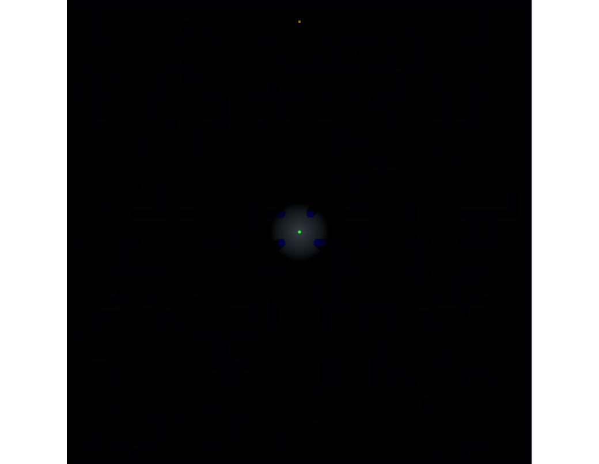
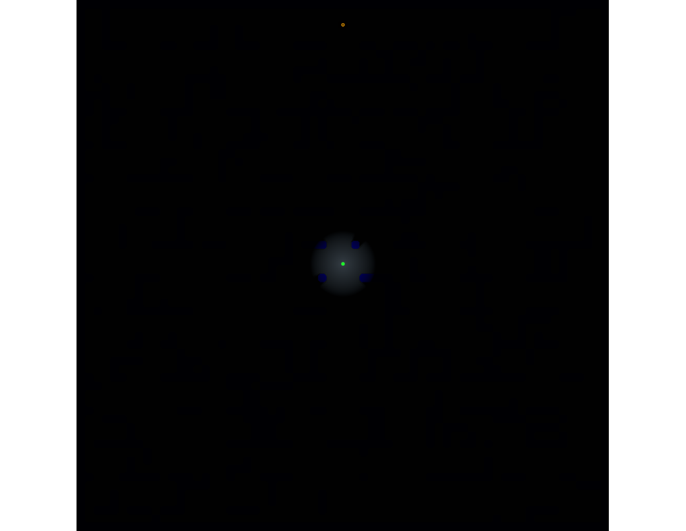
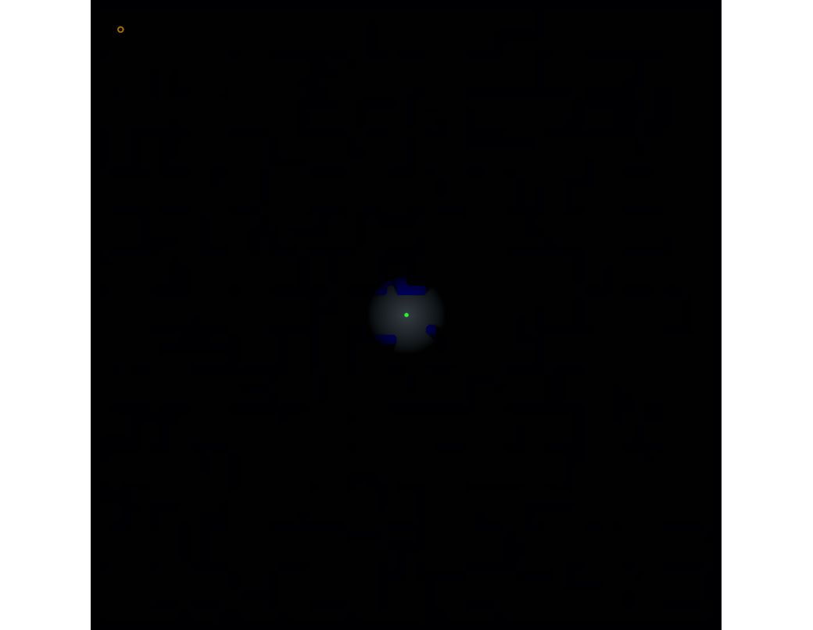

# Windows target evaluation

These are analysis fixtures for measuring real Win64 program import coverage. `anywasm analyze`
found unresolved static imports for every executable. Historical pre-shim D3D11 tutorial traces
stopped at the MSVC `basic_ios<char>` constructor. With local MSVC/UCRT DLLs, Tutorial03 now reaches
and renders a visible browser frame after target-used AVX instructions were added. The package-aware
capture recorded 59 draws, 30 presents, two pipelines, and no WebGPU validation errors. A fresh
HLE-only browser replay without local MSVC/UCRT DLLs continued rendering; its 45-second report recorded
2,759 draws, 1,380 presents, 5,519 passes, two pipelines, and zero WebGPU validation errors. It ended
with the page still in `Starting`, without terminal process status. The only 404 was the browser's
`/favicon.ico` request; the page context reported no failed requests or HTTP errors for sample resources.
The 2026-10-13 current-source recheck rebuilt from `ba39f00` and rendered the HLE-only textured cube
after 39.6 seconds: 59 draws, 30 presents, 119 passes, two pipelines, and 16 Asyncify yield/resume
pairs. After another 15 seconds it recorded 1,919 draws and 960 presents, still with no WebGPU errors,
unresolved-import stop, page error, failed request, or HTTP error. Chromium 151 logged only the favicon
404. The page remained in `Starting`, so later imports and orderly shutdown remain unverified. See the
[current-source report](target-data/tutorial03-hle-only-current-source-recheck-2026-10-13.json) and
[canvas capture](images/tutorial03-hle-only-current-source-recheck-2026-10-13.png). This current
evidence contradicts the claim that Tutorial03 stops at an unresolved MSVCP140 import before rendering.
On 2026-10-13, HLE-only Tutorial01 and Tutorial03 first-frame captures showed the colored triangle and
textured cube in cooperative CPU mode, with no local MSVC/UCRT DLLs and no unresolved runtime MSVCP
import before either frame. Both pages stayed active; the captures do not establish later imports or
shutdown. See [the capture record](target-data/diligent-hle-only-browser-2026-10-13.json) and screenshots
in [`docs/images/tutorial01-hle-only-current.png`](images/tutorial01-hle-only-current.png) and
[`docs/images/tutorial03-hle-only-current.png`](images/tutorial03-hle-only-current.png). An earlier
HLE-only CLI capture without runtime DLLs passed the observed narrow stream constructors,
stream-buffer lock/unlock, `good`, `sputn`/`xsputn`, `setstate`, uncaught-exception query, `_Osfx`,
unsigned-integer insertion, the stream and iostream destructors, and `sputc`, then faulted at
`tutorial03_texturing.exe+0x34fc` while inserting the ANSI string `\x1b[39m`. Static imports remain a
packaging concern when those DLLs are absent. A fresh source-built analyzer recheck after adding
the MSVC global-locale getter and locale ID data cells reports 230 implemented / 21 missing imports,
with four MSVCP140 imports still unresolved. This report is static binding coverage; it does not
establish that any remaining import is called or blocks the rendered path. See the
[locale import recheck](target-imports/tutorial03-locale-import-recheck-2026-10-13.json).

### D3D9 fixed-function regression

A separate synthetic Chromium command-stream regression (not a selected-target run) verifies two-stage
PREMODULATE. Stage 0 passes arg1; stage 1 SELECTARG1 CURRENT multiplies the prior color and alpha by
its texture. The center pixel is `[0, 128, 64, 64]` with no WebGPU validation errors. Bump-environment
mapping and broader multi-stage cascades remain open.

The HLE-only Tutorial01 HelloTriangle also rendered its colored triangle in Chromium without local
MSVC/UCRT DLLs. At the 250,000-instruction worker slice, the bounded capture reported 659 draws,
330 presents, two pipelines, 16 Asyncify yields/resumes, and no WebGPU validation errors. The page
remained in `Starting`; process completion is not established. See
[`target-data/tutorial01-hle-browser.json`](target-data/tutorial01-hle-browser.json).

### Tutorial01 shared CPU worker probe

On 2026-10-12, the same HLE-only Tutorial01 bundle was replayed with `?sharedCpuWorkers=1` under
cross-origin-isolated Chromium. The harness supplied the locally built no-std worker module from
`target/wasm32-unknown-unknown/release/anywasm_cpu_worker.wasm`; the page confirmed
`crossOriginIsolated`, `SharedArrayBuffer`, and `[runtime] shared CPU worker mode enabled`. After 30
seconds the 1280x1024 canvas reported 719 draws, 360 presents, 1,439 passes, two pipelines, and no
WebGPU errors; Asyncify recorded 7,543 yields and resumes. The process remained active and the UI
status stayed at `Starting`; target completion was not observed. The screenshot request timed out,
and the console reported one unidentified 404 with no failed HTTP response.

Shared synchronization now tracks worker and coordinator dirty pages. Stable mappings use cached
mapping rows and transfer only dirty frames; mapping or protection changes trigger a full refresh.
The capture also exposed a scheduler fallback that stepped one guest instruction per coordinator
turn after the worker quantum expired. The fallback now runs a normal 250,000-instruction slice;
before that change it made roughly 300,000 single-instruction turns in 30 seconds without rendering.
The exact observation and limits are in
[`target-data/shared-cpu-worker-tutorial01.json`](target-data/shared-cpu-worker-tutorial01.json).
Asteroids has not been run; none of these fixtures is a full runtime acceptance pass.

### Synthetic parallel guest-thread fixture

`test/browser/parallel.mjs` packs and runs `fixtures/parallel_test.exe` through the shared CPU worker
pool in cross-origin-isolated Chromium. It requires the shared-worker mode, more than 500,000
worker-retired instructions, and a batch containing both guest contexts. The guest writes distinct
prime counts for each thread, stores different dynamic TLS values and TEB last-error values across
HLE boundaries, rendezvouses through an atomic guest-memory counter, checks a private stack sentinel
per thread, waits for both threads, and updates a shared total with a locked instruction. The
harness checks `t0=5133 t1=4459 total=9592 tls0=0x1111 tls1=0x2222 last0=0x3333 last1=0x4444
mainTls=0x5555 mainLast=0x6666 rendezvous=2 stack=2`, exit code 0, and an observed maximum of two
active worker slices. Both copied-frame and in-place modes now require overlap, the atomic rendezvous,
and both stack sentinels. The Chrome 155.0.8059.40 copied-frame run retired 908,335 worker
instructions across 11 two-context batches. A 2026-10-13 Chrome 151.0.7922.34 in-place run used the
runtime's imported shared `WebAssembly.Memory`, retired 927,479 worker instructions in one
two-context batch, observed two active slices, and exited 0 with the same guest results. A fresh
copied-frame and in-place replay also passed after fixing a publish-order race: exporting the active
x64 context can allocate its backing TEB page, so each pool now captures mapping metadata after
context export. Both fresh runs observed two active slices and passed the rendezvous, stack, and
TLS/TEB checks. Artifact hashes and exact results are in the
[`in-place replay`](target-data/shared-cpu-inplace-overlap-2026-10-13.json) and
[`publish-order fix`](target-data/shared-cpu-publish-order-2026-10-13.json) evidence. This verifies
the synthetic in-place worker path, not target speedup. The copied-frame run also caught
an x64 guest-thread entry stack bug: the runtime omitted the
32-byte home area, so a compiled stack local landed beyond its allocated stack. Thread entry now
starts at `stack_base - 0x28`, placing the return address and home area according to the Win64
function-entry convention. See
[`target-data/shared-cpu-overlap-2026-10-13.json`](target-data/shared-cpu-overlap-2026-10-13.json).
`MODE=fault` runs
`fixtures/shared_fault_test.exe`: a shared-worker breakpoint returns to the coordinator, the
vectored exception handler resumes the guest, and the process exits 0. `MODE=fail-startup` serves
HTTP 503 for the worker module; the same parallel fixture finishes cooperatively with zero worker
retirements and reports the fallback reason. The harness creates temporary AWB files, so no demo
bundle needs to be prebuilt. `test/shared-cpu-pool.test.mjs` also checks that two
contexts occupy separate worker slots and context offsets while sharing one process-wide
instruction reservation. It verifies failed-worker cleanup, partial-startup cleanup, pool disposal,
and rejection when cross-origin isolation is absent. An in-flight rejection regression also confirms
that asynchronous request cleanup does not touch a slot after pool disposal. Browser-level disposal
during active work remains unverified. The standalone no-std overlap probe directly
observed two workers active at once and checked atomic totals, context checksums, and stack guards. These
synthetic results do not establish target performance or Diligent acceptance.

### GTA shared CPU worker fallback replay

On 2026-10-13, `target-gta-diag/gta-start-game.mjs` started the local `gta_sa.exe` package in
Chrome 155.0.8059.40 with `GTA_SHARED_CPU=1`. The snapshot pool initialized with two workers and
retired 1,658,235 guest instructions, but recorded zero two-context batches. As GTA grew its guest
memory mappings, the pool fell back to cooperative execution with `guest mapping size exceeded
shared CPU page capacity`; later progress showed startup phase 8, about 273 million guest
instructions, and no terminal status while the page still reported `Starting`. The observed AGP
range requests returned HTTP 206 and WebGPU reported no errors. This run did not reach gameplay or
measure a speedup. The pool capacity transition and replay details are in
[`target-data/gta-shared-cpu-fallback-2026-10-13.json`](target-data/gta-shared-cpu-fallback-2026-10-13.json).

A rerun after shared-pool capacity growth was pushed used the same harness with two workers. It
remained in `shared-cpu-workers` through the previous fallback point and reached startup phase 8,
1,004 presents, 192,968,377 guest instructions, and 2,858,162 worker-retired instructions without a
fallback or WebGPU errors. AGP range requests again returned HTTP 206. The run recorded zero
two-context batches and did not establish gameplay, terminal status, or a performance comparison; a
generic browser 404 was not identified. See
[`target-data/gta-shared-cpu-capacity-growth-2026-10-13.json`](target-data/gta-shared-cpu-capacity-growth-2026-10-13.json).

## Sources and build

Built from DiligentEngine `efe5da2270c6edfc8b0d2e39e946b35acbeaa874`, with DiligentCore at
`074060cfd1db73064d7a18cf40df86af6531520c` and DiligentSamples at
`03a10e15e69c5ae1738a52175ae029f3f4275a90`. The upstream DiligentSamples project declares
Apache-2.0; its repository also notes that dependencies can have independent licences. The
Asteroids source carries an Intel-origin notice, so its code and assets need separate redistribution
review before it can be an acceptance target. No sample binaries or assets are copied into AnyWASM.

The executables were built with Visual Studio 2022 / MSVC 19.44 and Windows SDK 10.0.26100, using
CMake's Visual Studio 17 2022 x64 generator. D3D11 and D3D12 were enabled; OpenGL, Vulkan and WebGPU
were disabled. The local external checkout needed CMake workarounds to locate Git and the SDK's
`fxc.exe` from generated build rules. Those edits are confined to `target-eval/DiligentEngine` and
are not part of this repository.

## Analyzer results

Reports below were regenerated with `anywasm analyze <exe> --json` at AnyWASM commit
`54bc2a05aacf722810ad7e6c8556a9eab8599023`. The binaries were read from the external build tree;
none were copied into this repository. The static-runtime report records the same analyzer revision.

- `D:\target-eval\DiligentBuild\DiligentSamples\Tutorials\Tutorial01_HelloTriangle\Release\Tutorial01_HelloTriangle.exe`
- `D:\target-eval\DiligentBuild\DiligentSamples\Tutorials\Tutorial03_Texturing\Release\Tutorial03_Texturing.exe`
- `D:\target-eval\DiligentBuild\DiligentSamples\Samples\Asteroids\Release\Asteroids.exe`

The source-base revisions for these builds are pinned and verified: DiligentEngine
`efe5da2270c6edfc8b0d2e39e946b35acbeaa874`, DiligentCore
`074060cfd1db73064d7a18cf40df86af6531520c`, and DiligentSamples
`03a10e15e69c5ae1738a52175ae029f3f4275a90`.

| Program | What it exercises | Analyzer result | Missing blocker counts |
|---|---|---:|---|
| `Tutorial01_HelloTriangle.exe` | Win64 GUI triangle tutorial; built with D3D11 support and offers D3D11 at the device-selection dialog | 157 implemented, 93 missing | MSVCP140 65; USER32 12; IMM32 4; VCRUNTIME140 6; SHELL32 1; UCRT API sets 5 |
| `Tutorial03_Texturing.exe` | Win64 GUI textured cube tutorial; loads `DGLogo.png`; built with D3D11 support and offers D3D11 at the device-selection dialog | 158 implemented, 93 missing | MSVCP140 65; USER32 12; IMM32 4; VCRUNTIME140 6; SHELL32 1; UCRT API sets 5 |
| `Asteroids.exe` | Win64 50,000-asteroid benchmark; includes native and Diligent D3D11 and D3D12 modes | 141 implemented, 111 missing | MSVCP140 68; CONCRT140 17; NInput 9; VCRUNTIME140 6; D3D12 2; USER32 2; UCRT API sets 7 |

### Exact missing imports

These are the missing names reported by the analyzer. A dash means no missing import for that DLL;
the D3D12 and NInput DLLs do not appear in either tutorial's import report.

| DLL | Tutorial01_HelloTriangle | Tutorial03_Texturing | Asteroids |
|---|---|---|---|
| `USER32.dll` | `TrackMouseEvent`, `GetKeyboardLayout`, `GetDesktopWindow`, `EndDialog`, `LoadBitmapW`, `DialogBoxParamW`, `GetMessageExtraInfo`, `SetClipboardData`, `GetClipboardData`, `EmptyClipboard`, `CloseClipboard`, `OpenClipboard` | Same 12 symbols as Tutorial01_HelloTriangle | `EnableMouseInPointer`, `GetPointerInfo` |
| `IMM32.dll` | `ImmSetCandidateWindow`, `ImmReleaseContext`, `ImmGetContext`, `ImmSetCompositionWindow` | Same 4 symbols as Tutorial01_HelloTriangle | — |
| `SHELL32.dll` | `ShellExecuteW` | `ShellExecuteW` | — |
| `d3d12.dll` | — | — | `D3D12SerializeRootSignature`, ordinal `#101` |
| `NInput.dll` | — | — | `SetPropertyInteractionContext`, `RemovePointerInteractionContext`, `AddPointerInteractionContext`, `ProcessInertiaInteractionContext`, `DestroyInteractionContext`, `ProcessPointerFramesInteractionContext`, `RegisterOutputCallbackInteractionContext`, `CreateInteractionContext`, `SetInteractionConfigurationInteractionContext` |
| `api-ms-win-crt-heap-l1-1-0.dll` | `_callnewh` | `_callnewh` | `_callnewh` |
| `api-ms-win-crt-math-l1-1-0.dll` | — | — | `ilogbf`, `scalbnf` |
| `api-ms-win-crt-runtime-l1-1-0.dll` | `_register_thread_local_exe_atexit_callback`, `strerror_s`, `_invoke_watson`, `terminate` | `_register_thread_local_exe_atexit_callback`, `strerror_s`, `_invoke_watson`, `terminate` | `_register_thread_local_exe_atexit_callback`, `strerror_s`, `_invoke_watson`, `terminate` |
| `VCRUNTIME140.dll` | `__intrinsic_setjmp`, `_purecall`, `__std_exception_destroy`, `__std_exception_copy`, `__current_exception`, `__current_exception_context` | Same 6 symbols as Tutorial01_HelloTriangle | Same 6 symbols as Tutorial01_HelloTriangle |

All three reports also import `VCRUNTIME140_1.dll`; its single imported symbol is implemented in
each. Other imported `api-ms-win-crt-*` symbols are implemented.

`SleepConditionVariableSRW` is now recognized by the HLE and therefore is not a static missing
import. The cooperative scheduler now retains and resumes condition-variable waiters. A fresh
30,000,000-step GLFW Demo replay continued beyond the observed wait and hit its cap in D3DCompiler;
that establishes progress after the wait, but does not by itself identify which waiter resumed.

| Runtime group | Tutorial01_HelloTriangle | Tutorial03_Texturing | Asteroids | Aggregate missing |
|---|---:|---:|---:|---:|
| `MSVCP140.dll` (C++ standard library) | 65 | 65 | 68 | 198 |
| `VCRUNTIME140.dll` | 6 | 6 | 6 | 18 |
| MSVCP140 + VCRUNTIME140 | 71 | 71 | 74 | 216 |
| `CONCRT140.dll` | 0 | 0 | 17 | 17 |

The tutorial sources are in the [DiligentSamples repository](https://github.com/DiligentGraphics/DiligentSamples),
which declares Apache-2.0 for the project while listing third-party dependencies separately. See the
[Tutorial 03 source](https://github.com/DiligentGraphics/DiligentSamples/tree/03a10e15e69c5ae1738a52175ae029f3f4275a90/Tutorials/Tutorial03_Texturing)
and the [Asteroids README](https://github.com/DiligentGraphics/DiligentSamples/blob/03a10e15e69c5ae1738a52175ae029f3f4275a90/Samples/Asteroids/README.md)
for the source programs and their stated rendering modes.

`analyze` reports statically imported symbols. The Diligent tutorials offer a device-selection
dialog, so the runtime traces passed `--mode d3d11`; both reached virtual D3D11 device discovery and
creation before stopping at the first unresolved MSVC C++ runtime import. Asteroids was analyzed
only; it was not run through AnyWASM. A missing symbol is a blocker if the guest calls it; the
report does not prove every import is reached on a selected rendering path. These counts prioritize
implementation work but do not replace runtime traces. The tutorials are samples, not games, and all
three programs remain preliminary candidates, not acceptance runs. Asteroids also remains outside
the redistributable acceptance set until its Intel-origin code and sample media have a documented
licence review.

### Historical first D3D11 tutorial runtime stops (before the constructor HLE)

The dynamic-runtime Release outputs were run with the selected D3D11 backend and a 500,000,000-step
cap before the constructor HLE was added. Both stopped before reaching the cap. Their traces pass
adapter enumeration, `D3D11CreateDevice`, and `ID3D11Device1::CheckFeatureSupport`, then stop at the
same imported MSVCP140 constructor:
`??0?$basic_ios@DU?$char_traits@D@std@@@std@@IEAA@XZ`. The HLE trace labels the missing thunk
`unknown!` because that import is not implemented; the analyzer maps it to `MSVCP140.dll`.

| Program | AnyWASM stop | Import caller | Last reached D3D11 path |
|---|---|---:|---|
| `Tutorial01_HelloTriangle.exe` | exit 120, unimplemented `basic_ios<char>` constructor | `0x140003320` | `D3D11CreateDevice`, feature queries, adapter/output enumeration |
| `Tutorial03_Texturing.exe` | exit 120, unimplemented `basic_ios<char>` constructor | `0x140004660` | `D3D11CreateDevice`, feature queries, adapter/output enumeration |

### MSVCP constructor follow-up

On 2026-10-12, inspection of the installed `MSVCP140.dll` showed the exact default-constructor
initialization for `basic_ios<char>`, `basic_ios<char16_t>`, and `basic_ios<wchar_t>`: each sets its
vtable, zeros the stream pointers, flags, locale/callback storage, and returns `this`; the narrow
variant clears one byte at offset `0x58`, while the two wide variants clear a word. The HLE now maps
`msvcp*` to its own diagnostic group and implements these field writes. It uses a synthetic vtable
with an explicit unresolved destructor thunk; other virtual calls are not implemented.

The rebuilt source analyzer lists the `char` and `wchar_t` constructors as implemented for both
tutorials. A later local probe package included the installed `MSVCP140.dll`, `VCRUNTIME140.dll`,
`VCRUNTIME140_1.dll`, and `ucrtbase.dll`. This exposed and led to HLE support for the observed
`_wsetlocale` call and resolution of bundled `api-ms-win-crt-*` imports through the single loaded
UCRT module. Both MSVC runtime DLLs then completed process attach.

With those local DLLs, `Tutorial01_HelloTriangle` passed `GetLogicalProcessorInformationEx` for
`RelationProcessorPackage`, using the runtime's one-processor topology, and reached D3D11 resource
creation and D3DCompiler. A 30,000,000-step module trace hit its cap inside `d3dcompiler_47.dll`.
A separate 100,000,000-step run hit its cap at `Tutorial01_HelloTriangle.exe+0x2cbb`; the observed
instruction sequence is in a string-buffer growth path, which does not establish a new runtime
failure. A later 250,000,000-step Release replay was stopped before its result was captured. These
probe DLLs are local under the ignored `target` tree and do not establish a supported runtime package
or a redistribution decision.

### Tutorial03 Texturing probe with local runtime DLLs

The probe VFS used the Texturing sample's Release files plus the same locally installed MSVC and UCRT
runtime DLLs. With the HLE/API-set path loaded, `Tutorial03_Texturing` passed DLL initialization and
reached D3D11 resource creation and D3DCompiler. A 30,000,000-step trace stopped at
`d3dcompiler_47.dll+0x1a326`; at 60,000,000 steps it had issued shader creation calls and stopped at
`d3dcompiler_47.dll+0x308884`. At 100,000,000 steps the trace showed two sequences of
`CreateVertexShader`, `CreatePixelShader`, and `CreateInputLayout`, followed by buffer creation, then
hit the cap at `tutorial03_texturing.exe+0x44280`. The log contains no guest `Present` and no
unimplemented-import stop. This confirms guest-side shader-object setup, not WebGPU shader translation
or a rendered frame. The source analyzer still reports many static MSVCP stream operations and
globals as missing when the runtime DLL is not bundled.

The 100,000,000-step trace was run from the repository root with this environment-specific VFS:

```powershell
$exe = '.\target\msvcp-vfs-probe03\Tutorial03_Texturing.exe'
.\target\debug\anywasm.exe run $exe --dir '.\target\msvcp-vfs-probe03' --trace-modules --max-steps 100000000 -- --mode d3d11 *> '.\target-trace\tutorial03-100m.log'
```

The VFS and trace log are ignored local artifacts and are not produced by the normal build.

### HLE-only Tutorial03 import probe

An earlier CLI analysis of the dynamic-runtime Tutorial03 executable reported 210 implemented and 41
missing static imports, including 44 of 65 `MSVCP140.dll` imports and 15 of 18 `VCRUNTIME140.dll`
imports. The latest analyzer report, regenerated from the current source, lists 227 implemented and
24 missing imports, including 58 of 65 MSVCP140 imports and all 18 VCRUNTIME140 imports. The four
newly implemented imports are narrow and wide `basic_streambuf::uflow` and `basic_streambuf::xsgetn`.
The report is [`target-imports/tutorial03-current-source.json`](target-imports/tutorial03-current-source.json).
Its preflight is `review`, `staticOnly: true`, and does not guarantee runtime success or prove that
these specific input methods are reached by the sample.

A short HLE-only VFS contained the tutorial executable, Diligent D3D11 DLLs, D3DCompiler, shaders,
and logo, with MSVC/UCRT runtime DLLs omitted. A run configured for 1,000,000 guest steps loaded
D3DCompiler and logged repeated `HeapAlloc` calls from `d3dcompiler_47.dll`, then exited with
`synchronous guest callback exhausted the run budget; its continuation cannot be resumed`. The
captured interval has no MSVCP import call or unresolved-import diagnostic. It also has no `Present`.
This native CLI probe identifies the callback budget as the next observed stop; it does not establish
whether later guest execution reaches additional MSVCP imports or produces a browser frame.

On 2026-10-13, a current-source HLE-only import trace with a 30,000,000-instruction cap passed the
stream and locale paths, including `_Cnd_wait`, `_Mtx_lock`, `_Mtx_unlock`, and
`_Thrd_hardware_concurrency`, then reached `d3dcompiler_47.dll+0x3a25d` at the step limit. The trace
contains 34 distinct MSVCP imports and no unresolved-import stop. It records no `Present`; the browser
replay above is the evidence for rendering. The command, artifact hashes, and observed import set are in
the [30M-step trace record](target-data/tutorial03-hle-cli-30m-2026-10-13.json). Its full trace log is
an ignored local artifact under `target-trace/`.

### Tutorial03 browser capture attempt

On 2026-10-12, the one-off Playwright harness ran the packaged Tutorial03 with the local MSVC/UCRT
runtime DLLs with normal 250,000-instruction worker slices. After 16 Asyncify yield/resume pairs, it
crashed at `tutorial03_texturing.exe+0x17a0` after 139,715,814 guest instructions with
`Decode(Unsupported("VEX3 0F3A instruction"))`. The bytes at that RVA are
`c4 e3 79 04 c5 55`, which decode as `VPERMILPS xmm0,xmm5,0x55`. GPU stats show zero draws,
dispatches, presents, passes, and pipelines, with no WebGPU validation errors. The 1280x1024
back-buffer readback has zero nonblack and zero nontransparent pixels; visual inspection of both
the back-buffer PNG and canvas screenshot confirms the blank output. The page also logged one 404
resource error. This identifies a CPU decode blocker before GPU submission for this run, rather
than an unresolved MSVCP import. The bundle, report log, and images are ignored artifacts under
`target/` and `target-trace/`.

Static disassembly of the surrounding target code shows the same XMM immediate form with selectors
`0x00`, `0x55`, `0xaa`, and `0xff`, interleaved with `VMULPS` and `VADDPS`. The CPU source now
decodes and executes immediate and variable XMM/YMM forms of both `VPERMILPS` and `VPERMILPD`, plus
packed-single `VMULPS` and `VADDPS`. The historical first browser capture stopped at VPERMILPS; the
current-source capture below passes that sequence. Intel's
[VPERMILPS instruction reference](https://cdrdv2-public.intel.com/835757/325383-sdm-vol-2abcd.pdf)
specifies the `VEX.128.66.0F3A.W0 04 /r ib` form, two selector bits per 32-bit destination lane,
and zeroing of the destination's bits above 128.

### Tutorial03 current-source browser frame

On 2026-10-12, the release Wasm runtime was rebuilt from current CPU/runtime sources, Asyncify was
rerun into `web/anywasm_wasm.wasm`, and the existing Playwright report harness loaded the local
Tutorial03 bundle containing MSVC/UCRT DLLs. The target passed the former `VPERMILPS` stop at RVA
`0x17a0` and the following `VMULPS` at RVA `0x17a6` (`c4 c1 78 59 d8`), then executed the
surrounding `VADDPS` sequence. The capture shows the textured Diligent logo cube in the page canvas
and back-buffer readback (1280x1024). At capture, GPU stats reported 59 draws, 30 presents, 119
passes, two pipelines, and zero WebGPU validation errors; the image was fully opaque. No unresolved
import appeared before the capture.

The report harness captures as soon as GPU stats become available, so its status text still says
“Starting”; it does not wait for process termination. The page also logged one 404 resource error.
This confirms browser rendering reached a visible frame with local runtime DLLs, but leaves the
sample's later execution and terminal status unverified. A fresh bounded rerun recorded the visible
textured cube in a 1280x1024 fully opaque readback, with 59 draws, 30 presents, 119 passes, two
pipelines, 16 Asyncify yield/resume pairs, and an empty WebGPU error list. Visual inspection confirms
the cube is visible in `target/Tutorial03_Texturing-task7-runtime.canvas.png`. The HLE-only CLI probe
without those DLLs still stops at its callback budget before proving whether later MSVCP imports are
reached. The bundle and screenshots are ignored local artifacts under `target/`.

### Tutorial03 HLE-only browser replay follow-up

On 2026-10-12, the release Wasm runtime was rebuilt from current sources and Asyncify-processed. A
45-second HLE-only browser replay without local MSVC/UCRT DLLs recorded 3,299 draws, 1,650 presents,
6,599 passes, two pipelines, and zero WebGPU validation errors. It stayed in `Starting` when the
report timed out, so process completion and later execution are unverified. The one browser-console
404 was for `/favicon.ico`; the page context recorded no failed requests or HTTP errors for sample
resources. This removes the favicon request as an observed sample-resource failure while leaving the
sample lifecycle question open.

A fresh 45-second rerun recorded 2,759 draws, 1,380 presents, 5,519 passes, two pipelines, and an
empty WebGPU error list. It again remained in `Starting` with no terminal status. The browser context
reported no failed requests or HTTP error responses; the only console 404 was `/favicon.ico`. The
later current-source run above verifies the same first frame after the stream-buffer HLE addition and
observes 15 seconds of continued rendering, but does not establish that Tutorial03 calls `uflow` or
`xsgetn` on this path.

### Tutorial01 HLE-only browser frame

On 2026-10-12, the release Tutorial01 bundle was packed from the external D3D11 Release directory
without local MSVC/UCRT DLLs. In Playwright Chromium revision 1234, the normal 250,000-instruction
worker slice produced a visible colored triangle. The 1280x1024 canvas capture reported 659 draws,
330 presents, 1,319 passes, two pipelines, 16 Asyncify yields and resumes, and no WebGPU validation
errors. This advances the sample beyond the historical MSVCP140 import stop on the HLE-only browser
path.

The page was still `Starting` after the bounded capture, with no terminal process status. The browser
console reported one generic resource 404, but the report did not observe a failed HTTP response, so
the resource is unidentified. The bundle hash is
`c027ddc6dea26ed77c0e7a01d7f9164e7d899ffa4edd4791b792fb03c32c39a6`; the report data is in
[`target-data/tutorial01-hle-browser.json`](target-data/tutorial01-hle-browser.json). The screenshot,
bundle, and one-off Playwright report script are ignored local artifacts under `target/`.

### 2026-10-13 HLE-only first-frame recheck

The HLE-only Tutorial01 and Tutorial03 bundles were replayed in Playwright Chromium revision 1234 with
the browser runtime in cooperative mode, now the default. Tutorial01 used a URL without a
`sharedCpuWorkers` parameter; Tutorial03 used `?sharedCpuWorkers=0`. Both bundles omit local MSVC/UCRT
runtime DLLs. Their first 30 presents each recorded 59 draws, 119 passes, two pipelines, 16 Asyncify
yields and resumes, and no WebGPU validation errors. Direct 1280x1024 back-buffer captures show the
colored triangle and textured Diligent cube. No unresolved MSVCP import appeared before either frame.

The pages remained in `Starting` at capture, which does not negate the verified frames; later imports
and orderly shutdown remain unverified. The source analyzer still lists missing static imports, including
MSVCP140 names, but these captures show those names are not a blocker on the exercised path. The browser
mode regression and explicit two-worker overlap results are in the linked capture record.

A current-source HLE-only Tutorial03 replay ran for 30 seconds after its first frame, then sent Escape
and continued for another 15 seconds. It reached 1,890 presents before Escape and 2,820 afterward, with
two pipelines and no WebGPU validation errors. No unresolved-import stop appeared; the page remained in
`Starting` with no terminal status, so later imports and orderly shutdown remain open. The browser logged
one 404 without recording its URL. The runtime and bundle hashes, counters, and screenshot are in the
[lifecycle capture record](target-data/tutorial03-hle-lifecycle-2026-10-13.json).

Reproduction from the repository root, using an HLE-only directory prepared from the named files
above:

```powershell
$dir = '.\target\msvcp-vfs-probe03-hle-only'
$exe = "$dir\Tutorial03_Texturing.exe"
.\target\debug\anywasm.exe run $exe --dir $dir --trace-imports --max-steps 1000000 -- --mode d3d11 *> '.\target-trace\tutorial03-hle-only-1m-current.log'
```

Reproduction of the historical pre-shim stop from the repository root (adjust `$exe` for each
tutorial):

```powershell
$exe = 'D:\target-eval\DiligentBuild\DiligentSamples\Tutorials\Tutorial01_HelloTriangle\Release\Tutorial01_HelloTriangle.exe'
$dir = Split-Path -Parent $exe
.\target\debug\anywasm.exe run $exe --dir $dir --trace-imports --max-steps 500000000 -- --mode d3d11
```

The later bounded probe used an ignored local VFS package containing the tutorial DLLs and copies
of the installed MSVC/UCRT runtime DLLs. From the repository root, its module-trace command was:

```powershell
$exe = '.\target\msvcp-vfs-probe\Tutorial01_HelloTriangle.exe'
.\target\debug\anywasm.exe run $exe --dir '.\target\msvcp-vfs-probe' --trace-modules --max-steps 30000000 -- --mode d3d11
```

That package is environment-specific and is not checked in or produced by the normal build.

The CLI now passes its full remaining step budget to each `Process::run` call and charges actual
retired instructions across frame stops. A regression fixture exercises a guest monitor callback
that exceeds the former 2,000,000-instruction internal slice. This removes an artificial CLI stop;
it does not make callbacks resumable when the configured run budget itself expires. The historical
import probes and the bounded Tutorial03 trace do not establish guest `Present`, browser WebGPU
execution, or visible pixels.

## Selected game candidate: DiligentSamples GLFW Demo

The pinned DiligentSamples README describes GLFW Demo as a simple maze mini-game. The repository
declares Apache-2.0 and says its contributions are free of IP encumbrances; it separately identifies
GLFW as zlib-licensed. The demo builds GLFW statically (there is no `glfw3.dll` output), uses
`GLFW_NO_API` for window/input, obtains the Win32 handle with `glfwGetWin32Window`, and loads the
D3D11 backend through `LoadAndGetEngineFactoryD3D11`. Its maze is generated procedurally; CMake
copies only `DrawMap.hlsl`, `GenerateSDF.hlsl`, `Structures.fxh`, and `RenderStates.json` to the
target output. The `sdf_map.jpg` source image is not copied there. Microsoft documents
`D3DCompiler_47.dll` as an application-local game redistributable. These source, asset, GLFW, and
compiler-runtime terms make this the selected candidate for evaluation. It was chosen over
Asteroids because upstream describes it as a mini-game, while Asteroids is an Intel-origin
performance benchmark with a separate source/media review still open. The built files remain in
the external temporary build tree and are not redistributed by AnyWASM. The output also imports the
MSVC C++ runtime; Microsoft states that redistributing those runtime files is subject to the
Visual Studio licence terms for a licensed Visual Studio user, so any later product bundle must
follow those terms.

Sources are pinned to DiligentEngine `efe5da2270c6edfc8b0d2e39e946b35acbeaa874`, DiligentCore
`074060cfd1db73064d7a18cf40df86af6531520c`, and DiligentSamples
`03a10e15e69c5ae1738a52175ae029f3f4275a90`. The sample README documents `--mode d3d11`; CMake
reported D3D11 as the only supported backend with D3D12, OpenGL, and Vulkan disabled. It was built
with Visual Studio 2022 x64 / Release in a temporary build directory outside this repository. The
external checkout has the previously documented local CMake workarounds. The configure used a
disconnected FetchContent mode and an empty NVAPI source override to avoid fetching an optional
NVIDIA dependency. It enabled samples/tools and kept the archiver and render-state packager enabled
because another generated sample target requires them at configure time.

```powershell
cmake -S '<external DiligentEngine checkout>' -B '<temporary build directory>' `
  -G 'Visual Studio 17 2022' -A x64 `
  -DDILIGENT_NO_DIRECT3D12=ON -DDILIGENT_NO_OPENGL=ON -DDILIGENT_NO_VULKAN=ON `
  -DDILIGENT_BUILD_SAMPLES=ON -DDILIGENT_BUILD_TOOLS=ON -DDILIGENT_BUILD_FX=OFF `
  -DDILIGENT_NO_SUPER_RESOLUTION=ON -DDILIGENT_NO_ARCHIVER=OFF `
  -DDILIGENT_NO_RENDER_STATE_PACKAGER=OFF -DFETCHCONTENT_FULLY_DISCONNECTED=ON `
  -DFETCHCONTENT_SOURCE_DIR_NVAPI='<empty local directory>'
cmake --build '<temporary build directory>' --config Release --target GLFWDemo --parallel 4
```

| Output beside `GLFWDemo.exe` | Size (bytes) | Role |
|---|---:|---|
| `GLFWDemo.exe` | 656,384 | Win64 game executable |
| `GraphicsEngineD3D11_64r.dll` | 1,011,200 | Diligent D3D11 backend |
| `Archiver_64r.dll` | 785,920 | Copied Diligent support DLL; runtime use not established |
| `D3Dcompiler_47.dll` | 4,740,688 | HLSL compiler dependency |
| HLSL/FXH/JSON files | 11,999 total | Runtime shaders and render-state description |

`anywasm analyze --json` was run separately on the executable and all three DLLs using AnyWASM
`4b37b09` (the repository revision before this documentation update). These are static import counts;
they do not show which imports are reached after D3D11 selection. The complete missing-symbol lists
are preserved in [`target-imports/glfwdemo-d3d11.json`](target-imports/glfwdemo-d3d11.json).

| Image | Implemented | Missing | Largest unresolved groups |
|---|---:|---:|---|
| `GLFWDemo.exe` | 153 | 134 | MSVCP140 64; USER32 36; GDI32 13; VCRUNTIME140 5 |
| `GraphicsEngineD3D11_64r.dll` | 74 | 96 | MSVCP140 75; VCRUNTIME140 7; D3DCOMPILER_47 2; USER32 1; SHLWAPI 1 |
| `Archiver_64r.dll` | 68 | 91 | MSVCP140 73; VCRUNTIME140 7; D3DCOMPILER_47 2; SHLWAPI 1 |
| `D3Dcompiler_47.dll` | 103 | 28 | KERNEL32 15; ADVAPI32 12; RPCRT4 1 |

Notable unresolved names include `RegisterRawInputDevices`, `GetRawInputData`, `SetPixelFormat`,
`SwapBuffers`, and `D3DCompile`/`D3DReflect`, as well as large MSVC C++ runtime import sets. The
executable has 134 statically unresolved imports and the selected D3D11 engine DLL has 96. The
AnyWASM runtime's reached-import behavior was not attempted because this static unresolved-import
surface is large. This candidate has not been run or behavior-verified and does not pass the
real-target acceptance gate. A missing static import alone does not prove that a selected path
reaches it.

### Static MSVC runtime experiment

A separate D3D11-only build was configured under
`D:\Dev Proj\WASM\target-eval\DiligentBuild-GLFWDemo-staticcrt`; the original build tree and
external source checkout were preserved. The top-level project requires CMake 3.10, so the
configure set `CMAKE_POLICY_DEFAULT_CMP0091=NEW` along with
`CMAKE_MSVC_RUNTIME_LIBRARY=MultiThreaded`. Generated MSBuild projects for `GLFWDemo`, the D3D11
engine, Common, and GLFW all specify `RuntimeLibrary=MultiThreaded`. DiligentFX was enabled because
this DiligentSamples checkout requires it; the already-populated EnTT and Abseil source directories
from the prior external build were passed as disconnected FetchContent overrides. CMake reported
D3D11 as the only enabled graphics backend, and the Release `GLFWDemo` target built successfully.
No binary was copied into this repository.

The regenerated static-runtime analyzer output is in
[`target-imports/glfwdemo-d3d11-staticcrt.json`](target-imports/glfwdemo-d3d11-staticcrt.json).
The earlier dynamic-runtime report remains in
[`target-imports/glfwdemo-d3d11.json`](target-imports/glfwdemo-d3d11.json), generated with an older
analyzer implementation. The current source-built CLI reports 68 missing imports across the EXE and
three DLLs when each image is analyzed with the release directory, so imports from bundled sibling
DLLs count as resolved. The older 349-miss dynamic-runtime snapshot used an older analyzer and is not
directly comparable.

| Image | Implemented | Missing | Largest unresolved groups |
|---|---:|---:|---|
| `GLFWDemo.exe` | 167 | 37 | USER32 19; GDI32 10; KERNEL32 5; SHELL32 3 |
| `GraphicsEngineD3D11_64r.dll` | 115 | 6 | KERNEL32 6 |
| `Archiver_64r.dll` | 106 | 6 | KERNEL32 6 |
| `D3Dcompiler_47.dll` | 112 | 19 | KERNEL32 9; ADVAPI32 9; RPCRT4 1 |
| **Aggregate** | **500** | **68** | |

The static runtime leaves no reported MSVCP140, VCRUNTIME140, or UCRT import misses in these images.
The EXE's current misses include 19 USER32, 10 GDI32, 5 KERNEL32, and 3 SHELL32 symbols; the engine
and archiver each retain 6 imports, and D3DCompiler retains 19. The JSON records each unresolved
name.

### Third-party DLL loading audit

The current Release artifacts were inspected with the PE parser. `GLFWDemo.exe`,
`GraphicsEngineD3D11_64r.dll`, `Archiver_64r.dll`, and `D3Dcompiler_47.dll` each have a TLS
directory, but `Pe::tls_callbacks()` returns an empty list for all four. Their export tables contain
no forwarded exports. These binaries therefore do not exercise either callback or forwarder
handling.

A 30,000,000-instruction AnyWASM replay with `--mode d3d11` reached `user32!CreateWindowExW` and
`d3d11!D3D11CreateDevice`, then executed code in the bundled D3D11 engine and `D3Dcompiler_47.dll`
before reaching the step cap. This confirms that the selected target maps and executes code in those
DLLs; it does not verify their initialization order. Source inspection shows `load_image` reserves a
module before recursively loading its imports; the loader now records those dependency edges and
traverses them dependency-first before calling `DllMain`. Synthetic regressions exercise nested
dependencies during initial loading and `LoadLibrary`. The engine and compiler DLLs have nonzero
entry points; their process-attach calls returned successfully, but these selected images do not
establish target-specific ordering. `Archiver_64r.dll` also has an entry point, but its runtime load
was not observed. Static TLS data and process-attach TLS callbacks are initialized. Named forwarded exports are resolved opportunistically; ordinal forwarders
are dropped, while failed named forwarders are omitted and only fail if later imported.

The selected artifacts leave TLS callback and forwarded-export cases untested. Synthetic PE fixtures
verify process-attach callbacks run in image order before `DllMain`, receive the module base,
`DLL_PROCESS_ATTACH`, and a null reserved argument, and run for the EXE after DLL initialization.
Dependency-first DLL initialization is covered synthetically; a target trace containing TLS callbacks
and a bundled dependency chain remains outstanding.

The PE32 loader path has a focused synthetic regression with a 32-bit EXE and a two-DLL dependency
chain. It verifies the leaf DLL's TLS callback runs before its `DllMain`, both receive the expected
x86 process-attach arguments, and the importing DLL's `DllMain` runs afterward.

### Bounded AnyWASM trial

The EXE was run with the Release output directory as its VFS root so the companion DLLs and shader
assets were available, with `--mode d3d11` and a 3,000,000-instruction cap. The first traced run
reached static CRT command-line/code-page initialization, then faulted while trying to write 512
bytes to address zero in `kernel32!MultiByteToWideChar`. Argument tracing captured
`(1252, 1, src, 256, NULL, 0xbf00be00000000)`: `cchWideChar` is a 32-bit `int`, so its low 32 bits
were zero (a valid count-only query), while unused upper stack-slot bits were dirty. The HLE had read
the full 64-bit slot as the capacity and tried to write the conversion result to the null output
pointer.

The HLE now reads both signed length parameters from their low 32 bits, preserves
`cbMultiByte=-1` as the null-terminated input form, rejects `cbMultiByte=0` and negative output
capacity with `ERROR_INVALID_PARAMETER`, returns `ERROR_INVALID_PARAMETER` for a null output pointer
with nonzero capacity, and returns `ERROR_INSUFFICIENT_BUFFER` for a short non-null buffer. A new
freestanding guest fixture covers these cases. Microsoft documents `cchWideChar=0` as a count-only call that does not use the output pointer,
`cbMultiByte=-1` as including the terminating NUL, and lists both
`ERROR_INSUFFICIENT_BUFFER` and `ERROR_INVALID_PARAMETER` among possible errors
([API documentation](https://learn.microsoft.com/en-us/windows/win32/api/stringapiset/nf-stringapiset-multibytetowidechar)).
The x64 calling convention assigns arguments beyond the fourth to eight-byte stack slots, so the HLE
must honor the declared 32-bit parameter type when reading those values
([ABI documentation](https://learn.microsoft.com/en-us/cpp/build/x64-calling-convention?view=msvc-170)).
The new fixture was built locally with the installed VS 2022 `cl`/`link`; `fixtures/build.sh` now
includes it in the existing clang/lld-link fixture build. Native Windows probes returned
`ERROR_INVALID_PARAMETER` (87) for a null output with nonzero capacity, both with `cbMultiByte=-1`
and with an explicit byte count of 256. A null output with `cchWideChar=0` returned the required
size (256), and a non-null undersized buffer returned `ERROR_INSUFFICIENT_BUFFER` (122). The guest
regression follows those observed results; Microsoft's error list includes both codes but does not
map each code to each null-buffer case.

After that fix, the same bounded game run passed the conversion calls and reached a second null
write in `kernel32!LCMapStringEx`. The last captured call was
`(NULL, 512, src, 256, NULL, 0xbf00be00000000)`: `cchDest` is again a zero 32-bit count-only query,
but at the time of that trace the LCMap HLE read the full stack slot and tried to write 512 bytes
to address zero.
Microsoft documents `cchDest=0` as a count-only query that does not use `lpDestStr`
([API documentation](https://learn.microsoft.com/en-us/windows/win32/api/winnls/nf-winnls-lcmapstringex)).
That LCMap count-query fault has since been addressed. At this earlier checkpoint the trace passed
the `LCMapStringEx` call and reached thread creation. Thread creation executed finite callbacks,
then the pre-scheduler runtime stopped explicitly at `kernel32!SleepConditionVariableSRW` because
it could not resume a blocked guest thread. No GLFW window or D3D11 renderer was observed at that
checkpoint. GLFW's Win32 window-creation path is also known from
source inspection to call `SHELL32!DragAcceptFiles` unconditionally; that later call remains
unreached and its behavior has not been verified in this target.

### Current checkpoint after scheduler, CPU, and API slices

The cooperative scheduler and synthetic regressions cover retaining and resuming guest contexts for
condition-variable waits. An earlier bounded run stopped at `kernel32!SleepConditionVariableSRW`
because its blocked guest continuation could not be resumed. A fresh current-tree 30,000,000-step CLI
replay reached the same call with `nested=0`, logged 13 `WakeAllConditionVariable` calls afterward,
continued into D3DCompiler, and hit the instruction cap. Reproduction from the repository root:

```powershell
$release = 'D:\Dev Proj\WASM\target-eval\DiligentBuild-GLFWDemo-staticcrt\DiligentSamples\Samples\GLFWDemo\Release'
.\target\debug\anywasm.exe run "$release\GLFWDemo.exe" --dir $release --trace-imports --max-steps 30000000 -- --mode d3d11
```

The trace is in `%TEMP%\anywasm-glfwdemo-bounded-recheck.log`. This run shows guest execution after
the wait but does not prove that the blocked thread itself resumed. No host GLFW window or D3D11
renderer was observed; the higher-cap guest traces below are separate evidence. Target-grounded
static TLS support assigns the image's TLS slot from index zero, initializes private blocks from each
module template, and saves/restores `TEB+0x58` per thread. The freestanding
`static_tls_thread_test.exe` verifies template initialization and worker/main isolation.
An additional synthetic PE32 image verifies static TLS vectors through the four-byte pointer at
`TEB+0x2c`, per-thread block isolation, zero-fill bytes, and x86 TLS callback arguments.

The next trace stopped at `GLFWDemo.exe+0x96d8` with a read fault at `0x4`. Its sequence loaded the
TLS vector from `GS:[0x58]`, loaded slot zero, then dereferenced a null block. After the TLS fix, the
trace advanced to `GLFWDemo.exe+0x36b3`, bytes `C4 E3 7D 19 C0 01` (`VEXTRACTF128 xmm0,ymm0,1`). A
target-specific implementation now extracts the upper 128-bit lane, and the following indirect
callback runs.

With the same 30,000,000-step cap, the target reaches virtual `CreateWindowExW`,
`D3D11CreateDevice`, swap-chain/resource setup, repeated condition-variable waits, and
`PathFileExistsW` for `C:\RenderStates.json`. A prior replay then reached `ExitProcess(3)` after
late-bound library resolution. Adding `advapi32!SystemFunction036` and `kernel32!RtlPcToFileHeader`
moved the trace beyond that branch. The current replay reaches `kernel32!RaiseException` with code
`0xe06d7363`, flags `1`, four arguments, and caller `0x14006c3bf` (`GLFWDemo.exe+0x6c3bf`). The
exception parameters contain MSVC C++ EH magic `0x19930520`, an exception object, ThrowInfo at
`0x1400dcb08`, and image base `0x140000000`; the ThrowInfo type descriptors identify
`std::runtime_error` and `std::exception`.

### Compiler-generated MSVC EH3/EH4 fixtures

The fixtures in `test/fixtures/msvc_eh/exception_fixture.cpp` were built on 2026-10-12 with MSVC
19.44.35214.0 and linker 14.44.35214.0 using `/MD /EHsc /std:c++17 /Od /Ob0 /W4`; the FH3 variant
also uses `/d2FH4-`. The analyzer reports 46 implemented imports and 0 missing for each fixture.
With an HLE-only VFS containing only the two executables and a 2,000,000-step cap, both variants
return 0 and reach `crt!exit`. Their traces cover by-value derived catches, adjusted base-reference
catches, catch-all, nested try/catch, and unwind funclets.

With a runtime VFS containing the installed x64 VC143 CRT redist DLLs and Windows
`System32\ucrtbase.dll` 10.0.22621.3593, both fixtures also return 0 under the same cap. Their traces
show guest calls from `ucrtbase.dll` and `vcruntime140.dll`; the EH4 path also executes
`vcruntime140_1.dll`. The runtime's unwind path reaches `RtlUnwindEx` and returns through the
compiler-generated catch continuations. API-set contracts without physical DLLs in the VFS continue
to use HLE, so this is not proof that every CRT API-set import executes in the guest UCRT. The VFS
contains local probe DLLs only and does not define a product packaging or redistribution decision.
See [`test/fixtures/msvc_eh/README.md`](../test/fixtures/msvc_eh/README.md) for the exact setup.

PE32+ exception tables are now parsed and validated; this image has 2,092 `.pdata` records, including
2,089 version 1 and 3 version 2 unwind records. Target-grounded frame search invokes the image's
language handler, and second-pass unwinding through `RtlUnwindEx` resumes at the C++ catch. A
synthetic regression checks handler calls, active unwind-stack use, flags, target RIP/RSP, and return
value. The bounded target replay confirms the catch path.

The runtime also has synthetic x64 SEH coverage for vectored-handler registration, ordering,
removal, and first-chance dispatch; a generic `RaiseException` code with arbitrary parameters; a
catch-all scope-table landing pad; filter callbacks receiving `EXCEPTION_POINTERS` and the
establisher frame; filter-requested continuation; and `__finally` calls during unwind. These fixtures
build the `.pdata`/scope-table records directly; they do not establish compatibility with a separately
compiled real-world `__try` binary. Synthetic tests also cover vectored-continue ordering and ignored
callback returns, plus top-level filter replacement and resumption with a modified context. PE32
exception support is partial: synthetic tests cover `RaiseException` through an x86 registration
handler and CPU exceptions through VEH resumption. The compiled `seh-x86.exe` fixture verifies
filter selection, continuation, and normal and unwind-time `__finally` execution. Native and
HLE-only runs now also verify a nested exception escaping a filter to an outer handler and an
exception raised during `__finally`. A synthetic handler test covers disposition 2 setting
`EXCEPTION_NESTED_CALL` before search continues. PE32 search now tracks the x86 dispatcher registration
pointer and clears the nested flag when it reaches that registration; the clear transition has no
runtime fixture yet. A second-pass x64 test covers disposition 3 by
redirecting to another searched frame, checking the resumed handler's unwind, target, and collided
flags, and preserving restored register state. X64 first-pass search also has a synthetic retry test:
the handler changes the dispatcher control PC within the loaded function; the resumed call sees the
per-frame CONTEXT pointer and collided flag.
PE32 second-pass code now passes the x86 one-pointer dispatcher context and implements a bounded
collided-registration redirect within the pre-searched path, validating the live registration chain
before changing `NT_TIB.ExceptionList`. A synthetic runtime guest-handler regression,
`pe32_seh_second_pass_resumes_after_a_collided_registration`, returns disposition 3 during phase two,
redirects to a searched registration, confirms that the already-unwound handler is skipped, and checks
the resulting `ExceptionList`, target EIP, and target ESP. The compiled MSVC fixture still does not
return disposition 3, so compiler-generated collided-handler integration remains unverified.
The dispatcher layout and redirect rule follow the x86 unwind path in the
[Windows Research Kernel source](https://github.com/mic101/windows/blob/master/WRK-v1.2/base/ntos/rtl/i386/exdsptch.c).
`ntdll!RtlUnwind` has an initial PE32 implementation: it walks the active registration chain, calls
unwind handlers, and transfers to the requested target IP with the supplied return value. The main
run loop consumes direct requests outside exception search. It now handles the x86
`EXCEPTION_CHAIN_END` sentinel by unwinding the full chain without exit-unwind flags and resuming at
the captured caller, following the Windows Research Kernel dispatcher. This sentinel path is
compile-verified but has no runtime fixture yet. A null `TargetFrame` now runs all termination
handlers and dispatches the preserved unwind record through vectored handlers and the top-level
filter. PE32 phase-two callbacks can now start a nested `RtlUnwind`; the new transfer takes over,
and the callback's registration is skipped after validating it against the active chain. An
`RtlUnwind` target remains registered and its handler is not called. The synthetic guest-handler
regression `pe32_nested_rtl_unwind_takes_over_a_phase_two_callback` covers this behavior; there is no
compiled target fixture yet. Nested x64 `RtlUnwindEx` from a phase-two callback now takes over the
active unwind when its context and target match the pre-searched frames. Redirects from the selected
C++ catch frame, nested targets behind the active frame, non-null unwind history tables, and targets
outside the pre-searched frames remain unsupported.
The rebuilt release WASM and
Asyncify module also pass all five HLE-only exception
fixture packages in Chromium with no page errors. The compiled PE32
EH3 fixtures verify typed by-value/reference catches, catch-all, nested catches, unwind cleanup, and
one caller/callee catch transfer; the direct-entry and normal-startup x86 variants return 0 in the
HLE-only runtime. Full nested-frame bookkeeping, redirects outside the searched x64 frames, non-null
unwind history tables, other PE32 frame layouts, and broader compiler metadata remain unverified. See
[`test/fixtures/msvc_eh/README.md`](../test/fixtures/msvc_eh/README.md)
for the fixture matrix and exit-code meanings.

An earlier trace checkpoint observed `advapi32!RegOpenKeyExA` probes for
`Software\Microsoft\Direct3D\Direct3D12` under predefined roots `HKCU` and `HKLM`, with options
`0` and access `0x20019`. At that time the HLE had no registry data store, so both non-empty paths
returned `ERROR_FILE_NOT_FOUND` (`2`). A replay capped at 100,000,000 instructions then remained in a
repeating stream of `kernel32!HeapAlloc` and `kernel32!TlsGetValue` imports until the step cap. This
did not establish why the target had not reached shader creation.

At this earlier checkpoint the trace did not reach shader creation or `Present`. Although the HLE
created virtual window, device, and swap-chain objects, no host window, host graphics device,
displayed frame, or game acceptance had been verified.

Reproduction used the Release output directory as the VFS root, `--trace-imports`, and
`--max-steps 100000000`. The import trace was captured in the task environment under
`%TEMP%\anywasm-glfwdemo-regopen-100m.log`; it is not a repository artifact.

### Current checkpoint: guest compute, draw, and present calls reached

Target-grounded CPU regressions now cover additional instructions seen in `GraphicsEngineD3D11_64r.dll`:
`VCMPEQSS` at RVA `0x17239`, `VBLENDVPS` at `0x1723e`, `VMOVD` at `0x17244`, 64-bit `SHRX` at
`0x40b1a`, `BLSI` at `0x4e9f0`, and `VPEXTRD` at `0x4ef0b`. The decoders accept only the observed
forms and have focused register, memory, flag, and vector-lane tests.

The SDF setup's null texture path was traced to `CheckFormatSupport`: Diligent selects a texture
format only when the returned flags include `D3D11_FORMAT_SUPPORT_TYPED_UNORDERED_ACCESS_VIEW`.
The HLE now advertises that bit for `DXGI_FORMAT_R32_FLOAT` only, creates 2D and 2D-array UAV views,
records `CSSetUnorderedAccessViews` (including supplied initial counts), and records D3D11.1
`*SetConstantBuffers1` ranges in 16-byte shader-constant units. Tests cover format selection, UAV
mip-slice tracking, UAV command encoding, and constant-buffer range encoding. The browser executor
records these bindings and aligns short or misaligned constant-buffer ranges for WebGPU.

After these slices, a D3D11-only `/MT` replay reached `CreateComputeShader`,
`CSSetShaderResources`, `CSSetSamplers`, `CSSetUnorderedAccessViews`, and the guest
`ID3D11DeviceContext3::Dispatch`. It then reached the first-frame `Draw` and
`IDXGISwapChain2::Present` calls. The trace contains no new unimplemented-import stop. The replay used
`--max-steps 1000000000` and was manually interrupted after repeated guest presents to stop the
unbounded demo loop; it did not exit normally or reach the step cap. The trace is in the task
environment at `%TEMP%\anywasm-glfwdemo-cb1-3b.log` and is not a repository artifact.

This is guest-side progress: the CLI records HLE commands, but does not execute them through the
browser's WebGPU executor. A separate browser command-stream fixture now verifies a 4x4 R32_FLOAT
UAV dispatch, reads back the `0.25` values, and samples the texture in a draw with pixel checks.
That validates the narrow typed-UAV executor path; it does not run the selected target's command
stream or verify its SDF shader, host-visible GLFW Demo pixels, or gameplay. The 84 static missing
imports, registry data store, and tutorial D3D11 paths also remain open.

### Guest instruction cost per present

The process-wide `retired_instructions` counter now includes instructions executed in synchronous
`Process::call_guest` callbacks, HLE instructions that return a frame stop, and successfully retired
instructions before a later instruction in the same cached block faults. The JS wrapper requires
the `aw_retired_instructions` export and fails clearly for a stale WASM module instead of falling
back to the active-thread `aw_icount` counter.

In the native CLI, a synchronous callback runs on the host stack and cannot suspend. If it does not
return before the current `Process::run` budget expires, the runtime returns a diagnostic crash
without exceeding that run budget; it cannot resume the callback on a later call. A GLFW Demo run
with 10,000,000-instruction slices stopped at 10,000,000 instructions in such a callback. The native
frame benchmark therefore defaults to one run slice equal to its full instruction cap. The
WASM/browser path uses Asyncify and has separate normal-slice continuation evidence below.

The `test/target_frame_bench.mjs` benchmark drives the target until guest `Present` frame stops,
reads the process-wide counter, and drains the recorded GPU stream at each stop. Its fixture
regression requests four stops from `d3d11_triangle.exe`; it records all three frames followed by
clean exit. A second fixture run caps execution at one guest instruction and confirms that no frame
is recorded. Measurement starts after `.awb` loading; guest DLL initialization performed during
loading is outside the frame deltas and elapsed frame times.

The corrected representative runs used Node `v24.16.0` on Windows x64 and the release WASM from
the accounting-fix working tree. The target bundle is the eight-file output of the D3D11-only `/MT`
Release build documented above. Each run requested eight frames under a 1,000,000,000-instruction
cap, with the default slice size equal to that cap. Reproduction:

```powershell
$release = 'D:\Dev Proj\WASM\target-eval\DiligentBuild-GLFWDemo-staticcrt\DiligentSamples\Samples\GLFWDemo\Release'
$bundle = "$env:TEMP\anywasm-glfwdemo-frame-measure.awb"
.\target\debug\anywasm.exe pack "$release\GLFWDemo.exe" -o $bundle --dir $release
node test/target_frame_bench.mjs $bundle --frames 8 --max-instructions 1000000000 --jit-min-prefix 65
node test/target_frame_bench.mjs $bundle --frames 8 --max-instructions 1000000000 --jit-min-prefix 1
```

The packed bundle contained 8 files (7,963,698 bytes); its SHA-256 matched an independent repack.
Both runs reached all eight guest `Present` stops, stayed below the cap, and did not reach a
terminal state. Frame 1 includes the main guest initialization performed after bundle loading;
frames 2–8 are subsequent presents. Counts are process-wide guest instructions. Times are Node wall
time between the post-load start and each frame stop:

| MOV prefix | First frame instructions / time | Frames 2–8 instructions each | Frames 2–8 time range / mean | Total instructions / elapsed | Emitter stats |
|---:|---:|---:|---:|---:|---|
| 65 (default, cached-only) | 580,777,731 / 42,168.83 ms | 3,200 | 0.214–0.482 ms / 0.262 ms | 580,800,131 / 42,170.67 ms | 0 compilations, 0 executions, 0 fallbacks |
| 1 (forced emission) | 580,776,966 / 67,687.26 ms | 3,200 | 0.242–0.527 ms / 0.293 ms | 580,799,366 / 67,689.33 ms | 687,197 compilations, 13,087,664 executions, 0 fallbacks; 11,494,229 register-register hits |

Forced emission made the cold first-frame pass 60.5% slower in this run. Only the existing
leading-MOV prototype was emitted; it made no fallback and did not improve this target sample. A
cached-only rerun of the same final WASM and bundle used 580,777,093 first-frame instructions
(580,799,493 total) and took 40,430.06 ms for the first frame, 638 fewer instructions and about
1.74 s faster than the table's cached-only run. This small sample does not characterize the source
of that variation. After the atexit-budget fix, the rebuilt WASM was measured again with the same
bundle and command: cached-only retired 580,771,924 instructions / 51,371.36 ms on frame 1
(580,794,324 total), while prefix 1 retired 580,774,467 / 76,179.10 ms (580,796,867 total).
Both repeat runs reached eight frame stops, with 3,200 instructions on each later frame, and had no
terminal state or cap hit. The latest cold emitted pass was about 48.3% slower than its cached-only
pair; elapsed times varied substantially across repeats, so this remains diagnostic data rather
than a stable performance comparison. The
benchmark runs the guest and HLE in Node; draining the stream does not execute D3D11 commands
through browser WebGPU. It measures neither host-rendered frame time nor target FPS, shader pixels,
gameplay, or a product performance target. The older 10–50x performance estimate remains
unverified.

Pinned upstream references: [DiligentSamples README](https://github.com/DiligentGraphics/DiligentSamples/blob/03a10e15e69c5ae1738a52175ae029f3f4275a90/README.md),
[GLFW Demo source](https://github.com/DiligentGraphics/DiligentSamples/tree/03a10e15e69c5ae1738a52175ae029f3f4275a90/Samples/GLFWDemo),
[GLFW Demo CMake](https://github.com/DiligentGraphics/DiligentSamples/blob/03a10e15e69c5ae1738a52175ae029f3f4275a90/Samples/GLFWDemo/CMakeLists.txt),
[GLFW license](https://github.com/glfw/glfw/blob/master/LICENSE.md), and
[Microsoft D3DCompiler redistribution guidance](https://learn.microsoft.com/en-us/gaming/gdk/docs/features/common/packaging/packaging-framework-packages?view=gdk-2604),
[Microsoft Visual C++ redistribution terms](https://learn.microsoft.com/en-us/cpp/windows/redistributing-visual-cpp-files?view=msvc-170).

### Browser attempt with the selected Diligent target

On 2026-10-11, an earlier build of `web/anywasm_wasm.wasm` and the D3D11-only `/MT` `GLFWDemo.awb`
were served to headless Chromium. The normal worker run slice was 250,000 instructions; this
attempt stopped after 8,524,265 aggregate guest instructions. The diagnostic was
`synchronous guest callback exhausted the run budget; its continuation cannot be resumed`.
That build did not resume the synchronous callback across worker slices; the later Asyncify replay
below verifies callback continuation in the WASM/browser path.

For diagnosis only, a Playwright response route temporarily changed the served worker's run
slice to 1,000,000,000 instructions; no repository runtime code was changed for this probe. The
guest advanced through its first roughly 580-million-instruction frame and the browser observed
30 or more guest `Present` stops. WebGPU reported invalid render pipelines followed by invalid
command buffers. A 1040x807 readback contained only transparent black pixels. The page did not
provide a successful completion status, and no target image was verified. The first rejected shader
and validation cause are now captured below.

The first rejected shader was guest shader id 16, a 1,636-byte `GenerateSDF.hlsl` compute shader
(SHA-256 `c8927fda2387000f58620450f2ffed95935283ea4794a224cc8d173fca0c7900`). Its SPIR-V
contained an f32 `OpConstant` with bits `0xfffffff8`, originating from the HLSL integer loop
initializer `l(-8)` in the Microsoft DXBC disassembly. SPIR-V permits this bit pattern, but Naga 30
rejects it as an invalid constant expression. `web/shaders.js` now preserves those bits through an
integer local and runtime bitcast; `test/shaders.mjs` regresses the captured DXBC. In a later bounded
Chromium replay, the compute shader module and pipeline validated and one dispatch executed.

At this checkpoint, render-pipeline validation failed because the translated vertex shader used
Naga's hidden `@group(3) @binding(0)` draw-parameter uniform while the graphics pipeline layout had
no binding there. The vendored Naga manifest defines four i32 values (`baseVertex`, `baseInstance`,
and two reserved values). Its generated WGSL subtracts the first two from WebGPU's built-in vertex
and instance indices to reproduce the D3D system values. The earlier 1040x807 readback contained
only transparent black pixels. This was an earlier run before normal-slice callback continuation was
verified; see the Asyncify replay below for the current worker-slice evidence.

### Browser replay after draw-parameter binding

`web/shaders.js` now reserves group 3 binding 0 for Naga's uniform and maps D3D UAV register `u#` to
binding `# + 1`. `web/gpu.js` writes the per-draw base vertex and first instance into a 16-byte
uniform allocation in the staging ring. `test/shaders.mjs` checks the translated bindings, and
`test/browser/run.mjs` renders two indexed instanced draws with different nonzero offsets; the
second draw must update the per-draw values for its green center pixel. The existing R32_FLOAT UAV
dispatch/readback/sample regression still passes after the binding shift.

### Normal-slice callback continuation replay

On 2026-10-12, the HLE-only seed-1 D3D11 `/MT` bundle (SHA-256
`34EA9EAB56BDE17338D749736CAF1C697001F3C3438A7BCD0CF82599135B5D36`) passed the browser harness's
callback-resumption gate in Playwright Chromium revision 1234 with the production 250,000-instruction
worker slice. Asyncify yielded and resumed 16 times; the capture recorded three draws, one dispatch,
three presents, and no WebGPU validation errors. The gate required at least one callback suspension
and successful resume, so this verifies the WASM/browser path across ordinary worker slices.

The page remained in `Starting` when captured, and the stored route did not finish: measured travel
was 137.12 pixels and final distance from its start was 210.54 pixels. This does not establish native
CLI callback continuation, nested callback scheduling, process completion, or full gameplay
acceptance. The measurement and exact reproduction command are in
[`target-data/glfwdemo-normal-slice-callbacks.json`](target-data/glfwdemo-normal-slice-callbacks.json).

### Diligent DrawMap shader translation

Two DXBC fixtures exercise the selected Diligent GLFW Demo's real `DrawMap.hlsl` vertex and pixel
stages. They were compiled with the vendored HLSL compiler from the Release `DrawMap.hlsl` source,
with `Structures.fxh` inlined, `VERTEX_SHADER`/`PIXEL_SHADER` defined respectively, and the `vs_5_0`
`VSmain` / `ps_5_0` `PSmain` entry points. The vertex fixture is 1,444 bytes (SHA-256
`19e9d1ddf8485e33d262eea01b4604c98623b2b8877437a1ac88ffd303c61be8`); the pixel fixture is 9,396
bytes (SHA-256 `1052ec7d432a92ac675edcac4a91c0ffa1b04f40d43dcfc7fae599e71392fb78`).

`test/shaders.mjs` checks the constant buffers, texture and sampler descriptors, stage outputs, and
ray-loop translation. `test/browser/run.mjs` compiles both translated WGSL modules and creates their
WebGPU render pipeline in Chromium. It then renders a 16x16 target twice with controlled uniforms,
using a clear-space SDF value and a zero-distance wall value; the center pixel is darker for the wall.
Shader compilation and pipeline validation report no errors. This checks SDF-dependent shading but
does not compare the rendered image with a native Diligent capture.

The reusable target smoke replay is `test/browser/target.mjs`. It temporarily serves the worker with
a 1,000,000,000-instruction run slice and per-frame GPU reporting, then captures the first reported
back buffer from a caller-supplied target bundle. Run it after packing the D3D11-only `/MT` build:

```powershell
$release = 'D:\Dev Proj\WASM\target-eval\DiligentBuild-GLFWDemo-staticcrt\DiligentSamples\Samples\GLFWDemo\Release'
$bundle = "$env:TEMP\anywasm-glfwdemo-frame-measure.awb"
.\target\debug\anywasm.exe pack "$release\GLFWDemo.exe" -o $bundle --dir $release
$env:CHROMIUM = 'C:\Users\sysadmin\AppData\Local\ms-playwright\chromium-1234\chrome-win64\chrome.exe'
$env:REQUIRE_TARGET_MOVEMENT = '1'
$env:REQUIRE_TARGET_MAP_RESET = '1'
node test/browser/target.mjs $bundle docs\images\glfwdemo-first-frame.png --check-movement --check-directions --check-aim --check-flashlight --check-map-reset --check-uav
```

On 2026-10-11, the latest Chromium 151.0.7922.34 replay produced a capture at 1040x807 with 5 draws,
1 compute dispatch, 5 guest presents, 10 render/compute passes, 2 pipelines, and no WebGPU validation errors.
The readback had 651,249 nontransparent, nonblack pixels; the center sample was RGBA `(18, 255, 26,
255)`. Visual inspection shows the dark SDF maze scene, blue wall marks, and green player marker:



The browser worker measures the time spent waiting for `requestAnimationFrame` after each guest
`Present` in 100 ns units. `Process::advance_time_100ns` converts each unit to ten internal 10 ns
ticks; this matches the runtime's 10 MHz `QueryPerformanceFrequency` and `QueryPerformanceCounter`
conversion. The process regression verifies the conversion, and the target's input replay confirms
that its QPC-based simulation advances at the measured frame-time scale while guest execution still
uses retired instructions.

The same target replay checks input through the rendered output. GLFW creates a hidden helper window
before the visible game window, so routing browser input to the first top-level HWND silently dropped
keys. The runtime now selects the focused visible window, or falls back to a visible top-level window.
Mouse coordinates are scaled from the canvas content area (excluding its border) to the Win32 client
area. The browser fixture uses a 256x192 CSS content box inside a 258x194 border box and verifies
that a point 130x101 CSS pixels from the content origin maps to `(520,404)` in the 1024x768 client
area of a 1040x807 guest window. The guest also requests `TrackMouseEvent(TME_LEAVE)` and receives
`WM_MOUSELEAVE` when the pointer exits the canvas. After correcting the host-time unit conversion, holding W for 500 ms moves
the green player marker 22.2 pixels upward. The seed-1 replay checks W/S/A/D and cursor-aimed Space
movement in all four directions; each moves 22.2–23.7 pixels in the expected direction. Holding the
left button for one second increases pixels above luminance 16 from 3,909 to 5,944 (2,035 more);
this verifies a visible flashlight response for this seed and aim direction. Measurements are saved
in [`target-data/glfwdemo-seed1-input-directions.json`](target-data/glfwdemo-seed1-input-directions.json),
[`target-data/glfwdemo-seed1-mouse-aim.json`](target-data/glfwdemo-seed1-mouse-aim.json), and
[`target-data/glfwdemo-seed1-flashlight.json`](target-data/glfwdemo-seed1-flashlight.json). Pressing Tab
regenerates the random map; in the post-fix replay, 170,386 of 839,280 pixels changed (20.3%), and the
target issued a second compute dispatch. The seed-1 input replay reached 363 presents and one compute
dispatch; the random-map reset replay reached 74 presents and two dispatches. Both had no WebGPU
validation errors. This reset path exposed Diligent's `ID3D11DeviceContext3::Flush1` followed by an idle-event
wait and an event-query polling loop. `Flush1` now signals its optional guest event, and D3D11 event
queries report completion after `End` in the ordered browser command-stream model. Rust regressions
cover hidden-helper input selection, idle-event signaling, and event-query completion. The W and Tab captures
are saved at [after W](images/glfwdemo-first-frame.after-w.png) and
[after Tab](images/glfwdemo-first-frame.after-tab.png).

A 2026-10-13 Chromium rerun corrected the cursor probe to scroll the canvas into view and map through
its inner content box. On the 1024x768 seed-1 frame, cursor aim moved the marker up/down/left/right
by 8.6, 9.2, 9.6, and 8.5 pixels respectively over the probe's 500 ms actions. The run reported 30
presents, one dispatch, and zero WebGPU errors. This confirms all four aim directions; the earlier
stored 22–24 pixel measurements remain the separate movement-magnitude record.

The general `Release` bundle command above uses a map binary whose `GenerateMap` seeds `std::mt19937`
from `std::random_device`; each process launch can therefore produce a different maze. On 2026-10-11,
the whole-frame 100-bright-pixel assertion failed on one map with only 36 additional bright pixels,
although the other input, map-reset, and SDF checks passed. That global count was sensitive to walls
elsewhere in the random map and did not establish whether the selected beam path was lit.

The flashlight probe maps the marker through the centered square game viewport, chooses an SDF ray
that stays in positive-clearance space until it reaches a wall within the 25-map-pixel flashlight
range, and compares 3x3 pixel patches at consecutive SDF texels along that ray before and after
input. It requires at least three consecutive patches to gain more than 8 mean luminance; the
whole-frame bright-pixel count remains diagnostic. The 2026-10-12 random-layout ray results used the
earlier SDF row mapping and are retained as historical data in
[`target-data/glfwdemo-random-run-flashlight-ray-check.json`](target-data/glfwdemo-random-run-flashlight-ray-check.json).

A corrected seed-1 recheck found that SDF rows increase upward on screen while captured image rows
increase downward. The flashlight probe now inverts the SDF-to-screen Y mapping and includes the
half-texel center offset. Two Chromium runs of the same seed-1 bundle selected the same clear ray;
each brightened all 14 sampled 3x3 patches by at least 8 luminance, with a longest lit run of 14 and
a maximum local increase of 80.33. The first run reported 30 presents, one compute dispatch, and no
WebGPU errors. Full seed-1 metrics are in
[`target-data/glfwdemo-seed1-flashlight-recheck.json`](target-data/glfwdemo-seed1-flashlight-recheck.json).

Two fresh Chromium launches of the random-map Release bundle used the corrected SDF row mapping on
2026-10-13. The bundle SHA-256 was
`616170BFD0423741FB05ACD6645E89396948C4CDA7CD8A12EC92524F6188988B`. One launch selected a leftward
ray with 17 clear texels and brightened all 15 sampled patches; the other selected a down-right ray
with 19 clear texels and brightened all 17 sampled patches. Every patch exceeded the 8-luminance
threshold, both runs reported zero WebGPU errors, and each completed 16 balanced Asyncify
yields/resumes. Executable and bundle hashes plus per-ray measurements are in
[`target-data/glfwdemo-random-run-flashlight-ray-corrected-recheck.json`](target-data/glfwdemo-random-run-flashlight-ray-corrected-recheck.json).
This verifies the flashlight response in two random layouts, not general gameplay acceptance.

The 2026-10-13 seed-1 input recheck measured W/S/A/D movement of 3.5, 4.2, 5.0, and 5.8 backing
pixels and cursor-aimed Space movement of 8.6, 9.2, 9.6, and 8.5 pixels. The aim probe scrolled the
canvas into view and used its content box. Both checks reported no WebGPU errors; their process
status remained Starting. Measurements are in
[the seed-1 input recheck data](target-data/glfwdemo-seed1-input-recheck.json).

The random Release map-reset recheck changed 152,943 of 786,432 pixels (19.4477%), advanced compute
dispatches from one to two, and reached 60 presents with no WebGPU errors. The process remained
Starting. Measurements are in
[the random map-reset recheck data](target-data/glfwdemo-release-mapreset-recheck.json).





### Deterministic native comparison

For a matched maze layout, a temporary D3D11-only `/MT` build used maze seed 1 and teleport seed 2;
the source edit was restored after the build. The native D3D11 run rendered at 1024x768. A browser
replay of the same bundle rendered at 1040x807, with 6 draws, 1 compute dispatch, 6 initial presents,
12 passes, 2 pipelines, and no WebGPU validation errors. The native and browser captures are checked
in as [native](images/glfwdemo-native-seed1.png) and
[WebGPU](images/glfwdemo-webgpu-seed1.png) images.

The deterministic maze seed is reused on each map construction, so Tab produces the same maze in
this bundle. The separate map-reset assertion uses the original random-seed build, where it verifies
the regenerated map pixels and second compute dispatch.

The capture hashes are SHA-256 `FF9CFF060A7179E9D489F13A76C6F9AA46DE3EDB88B9C1E9FAE163FFD4C07A3C`
(native) and `9007C1DFD3ACEB3EA2776B653C6C46BAA45106BEFC57614C587194F878B58C84` (WebGPU). Centered
crop comparison with FFmpeg gave 40.936 dB PSNR for 256x256 crops (browser origin 392,275; native
origin 384,256), and 35.014 dB PSNR with 0.897977 SSIM for the 128x128 scene-focus crops (browser
origin 456,339; native origin 448,320). Visual inspection confirms the same seed-1 wall layout,
player, and teleport. These are bounded visual comparisons: the backbuffer sizes and capture phases
differ, and they do not establish pixel equivalence or verify gameplay.

### Independent SDF UAV readback

`test/browser/target.mjs --check-uav` copies the selected compute UAV texture to a mapped buffer and
checks the output independently of the rendered backbuffer. The same seed-1 replay read view
12/resource 10 as a 128x128 `r32float` texture: all 16,384 values were finite, 3,776 were negative
and 12,608 positive, with a minimum of -2.236068 and maximum of 4.0. The target shader uses
`RADIUS=8` and `DIST_SCALE=0.5`, so the observed range is within its signed ±4 distance bound.
Sampled values at the top-left, center, and bottom-right were -1.414214, 2.0, and -1.414214. The
post-fix replay reproduced these values; the report is saved in
[`target-data/glfwdemo-sdf-seed1.json`](target-data/glfwdemo-sdf-seed1.json).
The standalone 4x4 R32_FLOAT fixture also reads all 16 written values as 0.25. This verifies the
selected target's SDF output for one deterministic state; it does not establish other UAV
formats/readback paths, all gameplay states, or game acceptance.

### Shared CPU worker target comparison (2026-10-13)

The current source-built browser runtime replayed the same static-CRT GLFW Demo bundle in
cross-origin-isolated Chromium with the production 250,000-instruction worker-loop slice, first
with shared workers disabled and then with `--shared-cpu-workers`. Both runs reached a visible
1024x768 frame, completed one SDF compute dispatch, used two pipelines, and reported no WebGPU
validation errors. The cooperative sample recorded 3 draws and 3 presents; the shared-worker sample
recorded 30 draws and 30 presents. Their progress traces were at 577,750,000 and 578,981,918 guest
instructions, respectively.

The shared pool created two workers and reported 2,800,103 worker-retired instructions, but recorded
zero two-context parallel batches. This target therefore confirms rendering through the shared
worker path, not concurrent guest execution. Neither capture reached an import stop or terminal
process status; both still showed `Starting` when the bounded first-frame harness closed. The
captures each contain 589,824 non-transparent and non-black pixels, with the green player marker at
(511.5, 383.5). Their wall layouts differ, so this pair does not establish pixel equivalence or a
speed result. The synthetic parallel fixture and overlap probe remain the evidence for actual worker
concurrency. Bundle and capture hashes, run modes, and counters are recorded in
[`target-data/glfwdemo-shared-cpu-workers-2026-10-13.json`](target-data/glfwdemo-shared-cpu-workers-2026-10-13.json);
the PNGs are local ignored artifacts under `target/`.

A fresh paired replay after the shared-pool publish-order fix used the current browser runtime and
the same bundle. Both runs again rendered the first frame without WebGPU errors. The worker run stayed
in shared-worker mode, retired 1,330,011 instructions, and observed one active slice with no
two-context batches. Its thread snapshot explains the result: the main thread was running while the
second guest thread was blocked on a condition variable. This confirms target rendering through the
current pool but supplies no concurrency or throughput result. The process remained active at
`Starting`; the captures still have different wall layouts. See
[`target-data/glfwdemo-shared-cpu-postfix-2026-10-13.json`](target-data/glfwdemo-shared-cpu-postfix-2026-10-13.json).

This verifies all four keyboard movement directions, cursor-aimed Space movement in all four
directions, a flashlight response for one seed/aim direction, and map regeneration in the selected
target. A historical controlled replay of the deterministic seed-1 bundle, recorded before the 2026-10-12
frame-time unit correction, also traversed the maze to its teleport, regenerated the map (compute
dispatches 1 → 2), and returned the player marker to the center with no WebGPU errors. It covered
45.01 map units in 1,834 key pulses over 34 measured route segments; the complete measurements and
bundle hash are in
[`target-data/glfwdemo-seed1-playthrough.json`](target-data/glfwdemo-seed1-playthrough.json). The
production-slice replay now maps positions through the centered square gameplay viewport, adapts
pulse counts, and corrects its path every eight pulses. The capture includes 4:3 letterboxing around
the square maze; scaling route X coordinates across the full frame placed distant waypoints several
pixels beyond their map positions.

On 2026-10-13, the same SHA-256
`34EA9EAB56BDE17338D749736CAF1C697001F3C3438A7BCD0CF82599135B5D36` bundle completed all 35 route
segments at the production 250,000-instruction worker slice. The player crossed the teleport and
returned to (511.84, 383.16), 0.48 pixels from its starting point; the largest segment-end error
was 1.31 pixels. The replay used 1,045 adaptive key pulses and 16 balanced Asyncify yields/resumes.
At the route end the harness pressed Stop; the page reported status 0 (`stopped`, exit code 0),
3,395 presents, two compute dispatches, and no WebGPU validation errors. This verifies a controlled
route and clean stop, not a natural guest exit. Full per-step measurements are in
[`target-data/glfwdemo-seed1-playthrough-normal-slice-2026-10-13.json`](target-data/glfwdemo-seed1-playthrough-normal-slice-2026-10-13.json).
The earlier failed recheck, which used full-frame scaling, remains in
[`target-data/glfwdemo-seed1-playthrough-recheck.json`](target-data/glfwdemo-seed1-playthrough-recheck.json)
as historical evidence. Other gameplay states and readback paths remain unverified. The default
250,000-instruction worker slice resumes synchronous guest callbacks through Asyncify, as verified in
[`target-data/glfwdemo-normal-slice-callbacks.json`](target-data/glfwdemo-normal-slice-callbacks.json).

## GTA San Andreas first-game POC

The default GTA demo bundle still enters through `gta_sa_compact1.0.exe`. The loader measurements
below deliberately used the installed `gta_sa.exe` through `?exe=gta_sa.exe`, preserving the compact
entry binary while profiling the alternate executable the owner requested. Both runs reached the
New Game loading artwork. Neither reached gameplay or a terminal process status during its capture.

### New Game loader and range read-ahead profile (2026-10-13)

The clean browser baseline used the existing 256 KiB on-demand AGP cache. A second run enabled one
same-file read-ahead chunk when sequential reads approached a chunk boundary. Both used Chromium,
the regular `gta_sa.exe`, the same local 5,013,432,573-byte AGP package, and the same automated menu
inputs. At 30 seconds after selecting New Game, the baseline had retired 261,716,763 instructions,
made 68 AGP range requests, and completed 53 Asyncify yields/resumes. The read-ahead run had retired
273,439,130 instructions, made 68 range requests, and completed the same 53 yields/resumes. At 60
seconds, the baseline had retired 339,709,519 instructions, made 70 range requests, completed 55
yields/resumes, and remained at 990 presents. The read-ahead run had retired 374,493,314
instructions, made 71 range requests, completed 56 yields/resumes, and reached 1,080 presents. No
asset read was pending at those checkpoints, and WebGPU reported no validation errors. The second
run displayed the game's loading artwork, not gameplay.

Between the 30- and 60-second checkpoints, the observed guest rate was 2.60 M instructions/s in
the baseline and 3.37 M instructions/s with read-ahead, a 29.6% increase in this single pair. This
is not a stable speedup claim: it needs a repeated paired run, and the similar request and
Asyncify counts do not establish that read-ahead caused the difference. The source trace did show
39 adjacent chunk transitions in 74 requests, which motivated same-file lookahead. Separate RIP
samples repeatedly entered GTA's statically linked `vsscanf` at `gta_sa.exe+0x4290d4` (preferred
address `0x8290d4`) while parsing map/effect rows; the wrapper at `0x8220ad` calls that parser, and a
sampled format was `%d %s %s %f %d`. This, along with idle range state during the long samples,
points to guest parsing as the larger remaining loader cost. The existing shared CPU worker mode
was also activated for a bounded replay, but that run remained at 653 presents and did not provide
a comparable New Game measurement.

The follow-up scheduler caps range requests at four and queues three same-file chunks for look-ahead.
An initial attempt did not pass the harness's 990-present New Game checkpoint: it remained at 653
presents, startup phase 5, and 22 Asyncify yields/resumes. A fresh Chrome 155.0.8059.40 run reached
the checkpoint and selected New Game. At 30 seconds it had retired 262,173,658 instructions, made
67 AGP range requests, and completed 53 Asyncify yields/resumes. At 60 seconds it had retired
351,161,901 instructions, made 70 requests, completed 56 yields/resumes, and reached 1,020
presents. Every AGP response was HTTP 206, there was no pending range request at either checkpoint,
and WebGPU reported no validation errors. The 60-second capture shows the New Game loading artwork;
the process remained in `Starting` and did not reach gameplay.

Against the recorded on-demand baseline, the current run retired 0.17% more instructions at 30
seconds and 3.37% more at 60 seconds. Its measured 30-to-60-second rate was 2.97 M instructions/s,
compared with 2.60 M/s in the baseline and 3.37 M/s in the earlier one-chunk read-ahead run. This is
one comparison, not a stable speedup claim; the earlier 653-present attempt was not comparable.
Hashes, request counts, and exact checkpoints are in
[`target-data/gta-newgame-range-cache-profile-2026-10-13.json`](target-data/gta-newgame-range-cache-profile-2026-10-13.json).
The current screenshot remains a local ignored artifact under `target/`.

### Browser package library

The page now accepts static catalog URLs, installs exact-version dependency closures into IndexedDB,
checks the AWB SHA-256 and AGP header/index SHA-256, and launches the installed entry while keeping
the AGP payload range-streamed. The local GTA catalog was generated with
`scripts/pack-gta-sa.ps1 -MetadataOnly`, which checked that the existing local AWB/AGP matched the
installed file inventory without rewriting the 5,013,432,573-byte AGP. A Chromium install displayed
the installed GTA package; launching it reached 30 presents with no page or GPU errors before the
bounded capture ended. This did not reach gameplay. A separate 10-case headless Chromium suite is
reproducible with `node --test test/browser/package-manager.test.mjs`; it covers invalid catalog and
manifest data, missing/cyclic/conflicting dependencies, the 128-package graph boundary, failed
replacement downloads, storage-quota errors, reload persistence, uninstall, and dependency
protection. Mod overlays remain unverified.

## Next evidence needed

- The corrected seed-1 route now reaches its teleport and a controlled terminal stop. Flashlight
  behavior at more aim positions, other gameplay states, other UAV formats, and general staging
  readback remain untested.
- The virtual registry now keeps process-local volatile keys and values. The `RegOpenKeyA`,
  `RegOpenKeyExA`, `RegCreateKeyExA`, `RegSetValueExA`, `RegQueryValueExA`, and `RegCloseKey` slice
  supports case-insensitive key/value lookup, nested create/open, two-pass value sizing, and
  `ERROR_MORE_DATA`.
  It has no seeded target configuration, persistence, enumeration, or wide-character API support;
  add values only when target evidence identifies the path and required contents.
- HLE-only Tutorial01 and Tutorial03 now have visible cooperative-mode first-frame captures without
  local MSVC/UCRT DLLs; neither hit an unresolved runtime MSVCP import before rendering. Their pages
  remained in `Starting`, so later imports and orderly shutdown are still unverified. A controlled
  close/input replay can establish lifecycle behavior without treating the tutorials' active render
  loops as failed first-frame runs.
- Keep Asteroids outside the redistributable acceptance set until the Intel-origin code and sample
  media have a documented licence review.
- The D3D11-only GLFW Demo remains the selected game candidate. The latest package-aware source-built
  `/MT` analysis reports 84 missing imports across the EXE and three DLLs. A prior status note listed
  96, which this build does not reproduce; analyzing each image without `--dir` reports 88 because
  four imports from bundled D3Dcompiler are treated as unresolved. The older dynamic-runtime snapshot
  reported 349 with an older analyzer. Conversion, version, path,
  scheduler, static TLS, selected target VEX/BMI, secure random,
  PE unwind primitives, the selected C++ catch path, D3D11 UAV binding, and constant-buffer ranges
  have regressions. The latest 1,000,000,000-step trace was interrupted after it reached guest
  compute dispatch, draw, and repeated present calls. The browser target replay now verifies host
  rendering, all four movement directions, cursor-aimed Space movement in all four directions, a
  seed-1 flashlight response along the corrected SDF ray, two random-layout flashlight rays, Tab map
  regeneration, and a production-slice seed-1 route through its teleport. Native comparison and
  independent UAV readback remain bounded to the recorded cases, and broad gameplay acceptance
  remains open.
